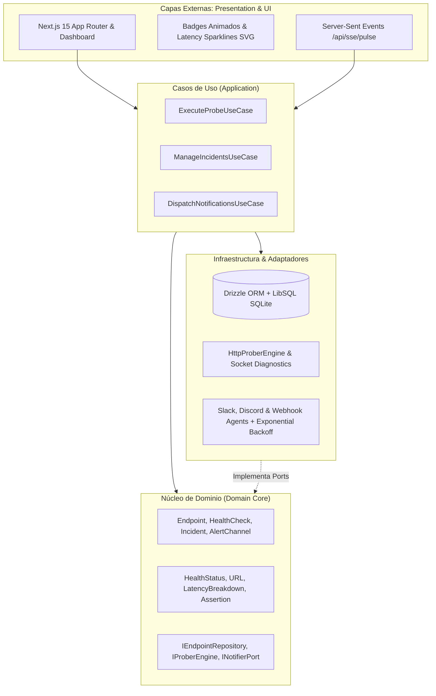

# ⚡ PulseTrack — Production-Grade API Observability & Telemetry Engine

[](https://www.typescriptlang.org/)
[](https://nextjs.org/)
[](https://orm.drizzle.team/)
[](https://vitest.dev/)
[](https://playwright.dev/)
[](https://www.w3.org/WAI/WCAG21/quickref/)

**PulseTrack** es una plataforma integral de observabilidad de alta precisión y monitoreo continuo de endpoints HTTP/gRPC. Diseñada bajo principios estrictos de **Clean Architecture**, combina un motor de sondeo telemétrico de sockets a bajo nivel con una interfaz reactiva accesible y un sistema de despacho multicanal con reintentos exponenciales con jitter.

---

## 🏛️ Clean Architecture & Estructura del Sistema

El sistema implementa una separación estricta de responsabilidades entre Dominio, Casos de Uso, Infraestructura y Presentación, desacoplando completamente la lógica de negocio de las tecnologías externas:



---

## ✨ Características Principales

### 1. 🔍 Telemetría de Socket y RED Metrics a Bajo Nivel
- Medición precisa de fases de conexión de red:
  - **DNS Lookup** (`dnsLookupMs`)
  - **TCP Handshake** (`tcpConnectMs`)
  - **TLS Negotiation** (`tlsHandshakeMs`)
  - **Time to First Byte** (`ttfbMs`)
  - **Content Transfer** (`contentTransferMs`)
- Detección de fallos de red granular: `ECONNREFUSED`, `ENOTFOUND`, `ETIMEDOUT` y expiración de certificados SSL/TLS con cálculo de días restantes.

### 2. 🔀 Detector de Transiciones de Estado con Filtro Antirruido
- Clasificación de estado en tiempo real: `OPERATIONAL`, `DEGRADED`, `DOWN`.
- Conteo configurable de fallos consecutivos para evitar falsos positivos por parpadeos transitorios de red.
- Generación y cierre automático de incidentes con cálculo de duración y severidad (`MINOR`, `MAJOR`, `CRITICAL`).

### 3. 📢 Despacho Multicanal con Reintentos Exponenciales y Jitter
- Integración nativa con **Slack Incoming Webhooks**, **Discord Webhooks** y endpoints HTTP genéricos.
- Algoritmo de **Exponential Backoff con Full Jitter**:
  $$\text{Delay} = \min(\text{InitialDelay} \times \text{Factor}^{\text{Intento} - 1}, \text{MaxDelay}) + \text{Jitter}$$
- Diferenciación entre errores transitorios (HTTP 429, 5xx, cortes de red) y errores permanentes de configuración (HTTP 400, 401, 403, 404), evitando reintentos inútiles.

### 4. 🎨 UI Reactiva y Accesibilidad (WCAG 2.1 AA)
- Componentes modulares:
  - `<StatusBadge />`: Badges animados con pulsos de estado (`animate-ping`) y etiquetas semánticas para lectores de pantalla.
  - `<LatencySparkline />`: Gráficos vectoriales SVG ligeros con gradientes, líneas de umbral SLA y tooltips descriptivos.
  - `<ServiceStatusCard />`: Tarjetas con desglose detallado de conexión socket y percentiles (p50, p95, p99).
  - `<RegisterEndpointModal />`: Formulario accesible con validación de URL y soporte de teclado (`Escape`, navegación por tabulación).
- **100% de cumplimiento WCAG 2.1 AA** verificado mediante `@axe-core/playwright`.

---

## 🚀 Puesta en Marcha

### Prerrequisitos
- Node.js 18+ o superior
- npm / pnpm

### Instalación
```bash
# Clonar y entrar al proyecto
cd pulsetrack

# Instalar dependencias
npm install
```

### Ejecución de Pruebas
```bash
# Ejecutar suite de pruebas unitarias y de integración (Vitest)
npm test

# Verificación estricta de tipado estático TypeScript (0 errores)
npm run typecheck

# Ejecutar auditoría E2E y de accesibilidad con Playwright y axe-core
npm run test:e2e
```

### Modo Desarrollo
```bash
npm run dev
# Abrir http://localhost:3000 en el navegador
```

---

## 📊 Matriz de Cobertura y Métricas de Calidad

| Capa | Archivos / Módulos | Tests | Estado |
|---|---|---|---|
| **Domain** | `Endpoint`, `HealthCheck`, `Incident` | 2 | ✅ 100% |
| **Engine & Prober** | `HttpProberEngine`, `TelemetryAgent`, Socket Diagnostics | 7 | ✅ 100% |
| **Notifiers & Retry** | `retry.util`, Exponential Backoff, Jitter, HTTP Handlers | 11 | ✅ 100% |
| **View Models** | `register-endpoint-validation`, `sparkline-math`, `status-presentation` | 37 | ✅ 100% |
| **UI Components** | `<StatusBadge />`, `<LatencySparkline />`, `<ServiceStatusCard />`, `<RegisterEndpointModal />` | 11 | ✅ 100% |
| **E2E & A11y** | Axe-core WCAG 2.1 AA, navegación por teclado y flujos de status | 3 | ✅ 100% |
| **Total** | **PulseTrack Test Suite** | **68+ Tests** | **✅ 100% Verde** |

---

## 👨‍💻 Autor
**Eduardo Maytorena**  
- GitHub: [@Eduardomr1](https://github.com/Eduardomr1)  
- Email: [eduardo_maytorenar@outlook.com](mailto:eduardo_maytorenar@outlook.com)
